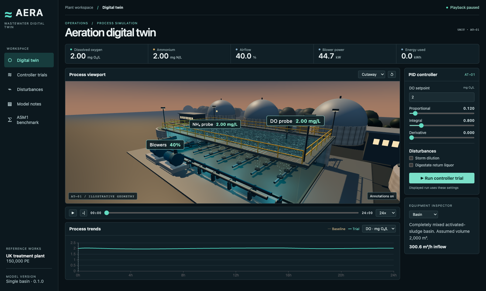
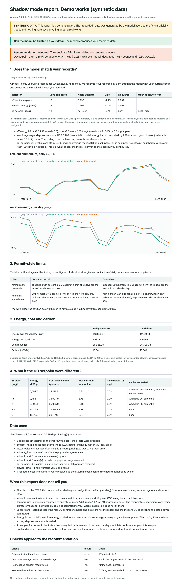
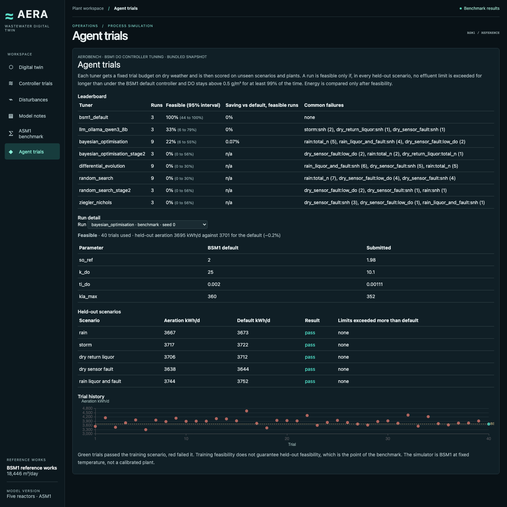
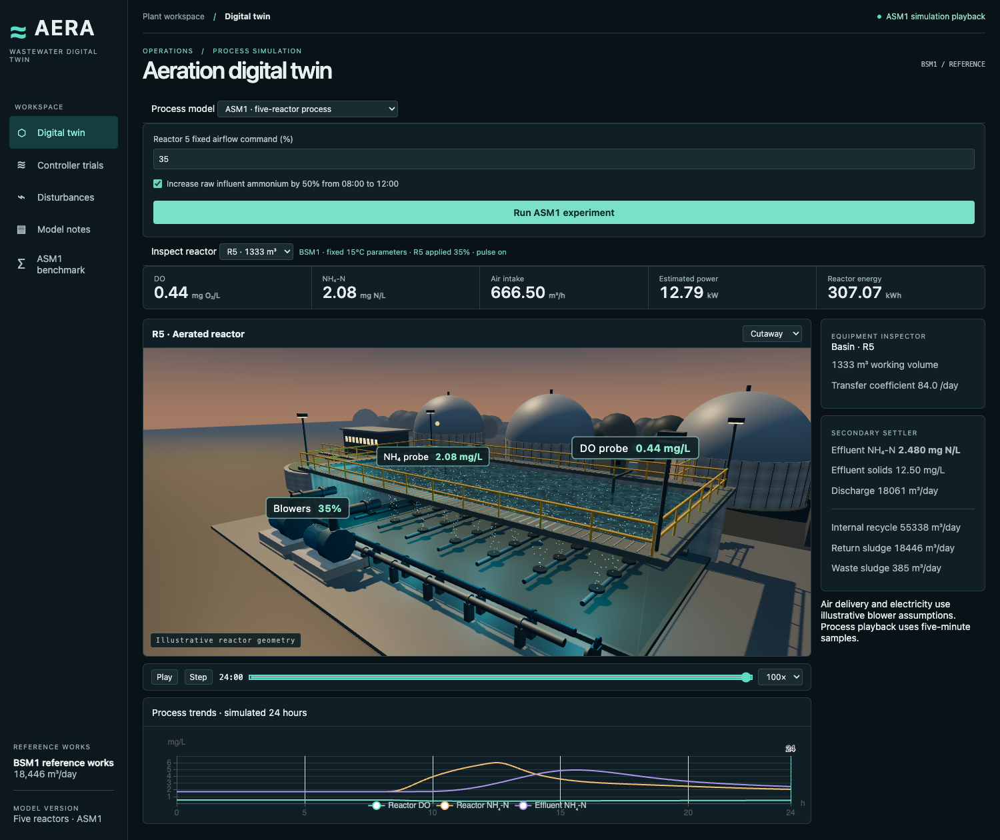

<div align="center">

# AERA

### A wastewater digital twin, a benchmark for AI controller tuning, and a safe "shadow mode" for real works

[](https://github.com/Bubblycornflakes/aera-digital-twin/actions/workflows/ci.yml)
[](LICENSE)


[**Live demo: Agent trials page**](https://bubblycornflakes.github.io/aera-digital-twin/)



</div>

AERA simulates the biological heart of a sewage treatment works, the aeration tanks, where blowers pump air into the water so bacteria can remove ammonia. Air is the biggest electricity bill on a works, so the question is simple: **could a different dissolved oxygen (DO) setting use less energy without breaking the discharge limits?**

The project has three parts that build on each other.

| Part | What it does | Start here |
| --- | --- | --- |
| **Shadow mode** | Takes a works' own historian export, replays it through the model under today's DO control and a candidate setpoint, checks the model against what the works recorded, and writes a plain-English report. Advice only; it never connects to a plant. | [docs/START_HERE.md](docs/START_HERE.md) |
| **AeroBench** | A benchmark: can an LLM agent or an optimiser tune the BSM1 DO controller from 40 simulation trials, and does the answer still hold on weather and faults it never saw? | [docs/AEROBENCH.md](docs/AEROBENCH.md) |
| **Digital twin** | The simulator itself: the IWA BSM1 benchmark plant (five reactors, ten-layer settler) with a 3D viewer, PID controller trials and disturbances. | [docs/BSM1_REPRODUCTION.md](docs/BSM1_REPRODUCTION.md) |

**Status, honestly.** Research software built by one person. Shadow mode has only been run on a synthetic works, never on real data, and it is not independently reviewed. Treat every result as research, not as a saving estimate for any real plant.

## Try it in two minutes

You need Python 3.13, [uv](https://docs.astral.sh/uv/) and Node 22.12 or later.

```bash
uv venv --python 3.13
uv pip install -r requirements.txt
npm ci --prefix frontend
.venv/bin/python scripts/fetch_bsm1.py      # IWA BSM1 archive, checksum verified, not redistributed
.venv/bin/python -m pytest -q               # full test suite
.venv/bin/python -m aera.site demo          # shadow mode on a synthetic works, writes an HTML report
./start.sh                                  # web app at http://127.0.0.1:5161
```

Or with Docker: `docker build -t aera . && docker run -p 8061:8061 aera`.

## Shadow mode

Aimed at a process engineer or asset manager at a works. No programming needed: the [guide](docs/START_HERE.md) is plain English.

- Imports a CSV export, checks it (gaps, flatlines, units, time zones) and fills what it safely can.
- Replays the period through a scaled BSM1 model under today's control and under a candidate DO setpoint.
- Validates the model against what the works recorded. It only says "validated" if both effluent ammonium and blower energy are scored and pass.
- Checks UK-style consent limits (absolute, percentile and annual mean), appraises energy, cost and carbon with ranges, and gives a guarded recommendation (ready, research only, or rejected).
- Optional calibration of nitrifier growth and oxygen transfer, seasonal temperature effects, and a read-only watch folder that runs it whenever a new export appears.
- Every run is written to a hash-chained audit log.



*The report for the synthetic demo works. Nothing in it comes from a real plant.* Thinking about a pilot? Read [docs/FOR_WATER_COMPANIES.md](docs/FOR_WATER_COMPANIES.md) and the [roadmap](docs/ROADMAP.md) for what is still missing.

## AeroBench

Tuners get 40 trials on dry weather, then are scored on held-out rain, storm, an ammonia pulse from sludge liquor and sensor faults, on three plant variants. Feasibility comes before energy: a setting only counts if no effluent limit is exceeded for longer than under the BSM1 default controller, in any held-out scenario.



Reference tuners, 40 trials, 3 plants (3 seeds for stochastic tuners):

<!-- leaderboard-short:start -->
| Tuner | Runs | Feasible (95% interval) | Saving vs BSM1 default, feasible runs |
| --- | --- | --- | --- |
| bsm1_default | 3 | 100% (44% to 100%) | 0.0% |
| llm_ollama_qwen3_8b | 3 | 33% (6% to 79%) | 0.0% |
| bayesian_optimisation | 9 | 22% (6% to 55%) | 0.07% |
| bayesian_optimisation_stage2 | 3 | 0% (0% to 56%) | n/a |
| differential_evolution | 9 | 0% (0% to 30%) | n/a |
| random_search | 9 | 0% (0% to 30%) | n/a |
| random_search_stage2 | 3 | 0% (0% to 56%) | n/a |
| ziegler_nichols | 3 | 0% (0% to 56%) | n/a |
<!-- leaderboard-short:end -->

Tuning on the training scenario rarely generalises: answers mostly fail the sensor-fault and rain scenarios. The two feasible Bayesian runs saved 0.16% and -0.01% of aeration energy, so nothing was gained over the default, which is hard to beat under this rule. With 3 to 9 runs per tuner the intervals are wide, and the feasible share also depends on the tolerance in the rule (sensitivity table in [docs/AEROBENCH.md](docs/AEROBENCH.md)).

One small local model, `qwen3:8b` through Ollama (free, no key), has been scored: it used only 4 to 6 of its 40 trials, needed the harness to re-prompt it 3 to 10 times per run, and its one feasible answer was essentially the BSM1 default. Claude and GPT models have not been scored; that needs a provider API key.

Run a tuner or a model yourself:

```bash
.venv/bin/python -m aera.run_benchmark --tuner examples.hill_climber:hill_climber --seeds 1
.venv/bin/python -m aera.leaderboard
.venv/bin/inspect eval aerobench_task.py --model <provider/model>    # provider API key in the environment
```

## The simulator

The closed-loop BSM1 plant reproduces the published dry, rain and storm results: aeration energy within 0.1%, effluent quality index within 0.1%, limit exceedance within 0.5 percentage points. The weakest quantities are effluent suspended solids (about 11% low on rain and storm), rain average total nitrogen (5% high) and rain average ammonium (6% low). Full table: [docs/BSM1_REPRODUCTION.md](docs/BSM1_REPRODUCTION.md).



## Layout

`aera/bsm1_dynamic.py` closed-loop plant · `aera/benchmark.py` scenarios, scoring, environment · `aera/tuners.py` reference tuners · `aera/aerobench.py` Inspect task · `aera/site/` shadow mode · `aera/run_benchmark.py`, `leaderboard.py`, `report.py`, `sensitivity.py`, `reproduction.py` tooling · `frontend/` web app · `examples/` plug-in tuner · `results/runs/` per-run results · `docs/` design, reproduction, validation.

## Limits

- Everything is simulation of a benchmark plant, with synthetic data for shadow mode.
- The feasibility tolerance, held-out scenarios and plant variants are the author's choices. BSM1 is public, so a language model may recall its default settings.
- Pumping, mixing and sludge production are not scored. The stage 2 ammonia cascade uses an ideal sensor.
- The 3D viewport shows the educational and ASM1 playback; Agent trials results are charts and tables.
- Seasonal temperature coefficients are typical literature values, not calibrated to any works.

## Licence and acknowledgements

MIT, see [LICENSE](LICENSE). The IWA BSM1 files are not part of this repository and have their own terms.

The BSM1 models are the property of the IWA Task Group on Benchmarking of Control Strategies and the implementations are from the Department of Industrial Electrical Engineering and Automation, Lund University (U. Jeppsson, C. Rosen and others), provided free for academic use. This project downloads the official release and does not redistribute it. The annual reference figures (a 150,000 population equivalent works) are the author's own assumptions.
